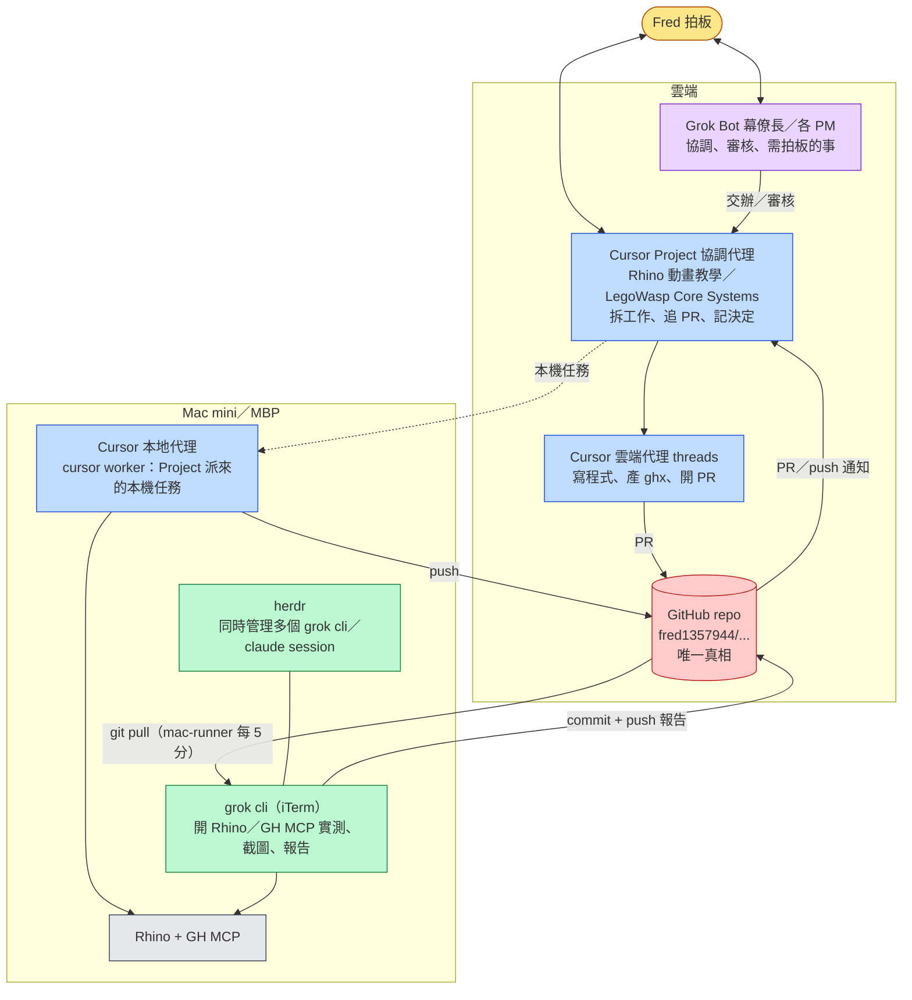

# FMD community plugin

## Project overview

- Target: FMD Plugin (TypeScript → bundled JavaScript for Qt QJSEngine).
- Entry point: `src/main.ts` compiled to `main.js` and loaded by FMD `PluginHost`.
- Required release artifacts: `main.js` and `manifest.json`.
- Host API types: `fmd.d.ts` / `fmd.ts`. Docs: `docs/PLUGIN_API.md` in the FMD app repo, or the snapshot in the GitHub template.

## Environment & tooling

- Node.js: current LTS (Node 18+ recommended).
- **Package manager: npm** (required for this sample — `package.json` scripts).
- **Bundler: esbuild** (required for this sample — `esbuild.config.mjs`). Alternative bundlers OK if they emit a single CommonJS `main.js`.
- Types: `fmd.d.ts` + runtime `Plugin` base in `fmd.ts`.

### Install

```bash
npm install
```

### Dev (watch)

```bash
npm run dev
```

### Production build

```bash
npm run build
```

## File & folder conventions

- **Organize code into multiple files**: split features; keep `main.ts` focused on lifecycle.
- Source lives in `src/`.
- Example structure:
  ```
  src/
    main.ts           # Plugin entry, lifecycle
    settings.ts       # Settings interface + defaults
    commands/         # Command implementations
    ui/               # Modals / views (when host supports)
    utils/
  fmd.ts / fmd.d.ts   # Host API types + Plugin base
  manifest.json
  versions.json
  ```
- **Do not commit** `node_modules/` or generated `main.js` (see `.gitignore`).
- Keep the plugin small. Prefer browser-compatible packages (no Node APIs — QJSEngine is not Node).
- Release artifacts at the top level of the plugin folder: `main.js`, `manifest.json`.

## Manifest rules (`manifest.json`)

- Must include: `id`, `name`, `version` (semver), `minAppVersion`, `description`, `permissions` (array).
- Optional: `author`, `authorUrl`, `fundingUrl`, `main` (default `main.js`).
- Never change `id` after release.
- Keep `minAppVersion` accurate when using newer APIs; the current host displays but does not enforce it.
- `permissions` gate host API calls — request the minimum set.

## Testing / manual install

Copy `main.js` and `manifest.json` to:

```text
<Workspace>/.fmd/plugins/<plugin-id>/
```

or

```text
~/.config/fmd/plugins/<plugin-id>/
```

Use a disposable test workspace. Turn on **Allow community plugins**, reload, then enable this plugin in **Preferences → Plugins**.

## Commands & settings

- User-facing commands via `this.addCommand(...)` / `api.commands.register`.
- Persist settings with `api.settings.get` / `set` (scoped per plugin id).
- Use stable command IDs; avoid renaming once released.

## Versioning & releases

- Bump `version` in `manifest.json` and map in `versions.json`: plugin version → min FMD version.
- GitHub release tag must match `manifest.json` version exactly (no leading `v`).
- Attach `manifest.json` and `main.js` as assets.

## Security, privacy, and compliance

- Default to local/offline. No network in v0 host API.
- No hidden telemetry. Disclose any future network use and require opt-in.
- Never execute remote code or auto-update outside normal releases.
- Read/write only inside the workspace via `vault.*` when available.
- Clean up listeners in `onunload` so disable/reload does not leak.

## UX & copy

- Sentence case for headings, buttons, titles.
- Arrow notation for navigation: **Preferences → Plugins**.
- Keep in-app strings short and consistent.

## Performance

- Keep `onload` light; defer heavy work.
- Debounce expensive work on `file-change`.

## Coding conventions

- TypeScript `"strict": true` preferred.
- Keep `main.ts` minimal; delegate feature logic.
- Bundle everything into `main.js` (CommonJS for QJSEngine host wrapper).
- Keep `onload` synchronous; FMD does not await its result. Handle errors gracefully.
- **Do not** use Node/Electron APIs.

## Agent do/don't

**Do**

- Add commands with stable IDs.
- Provide settings defaults.
- Write idempotent unload paths.
- Declare only needed `permissions` in `manifest.json`.
- Read `docs/PLUGIN_API.md` and keep examples copy-pasteable.

**Don't**

- Introduce network calls (unsupported in v0).
- Access files outside the workspace.
- Rename plugin `id` or published command ids.
- Commit `main.js` / `node_modules`.
- Assume Obsidian APIs exist — FMD uses `fmd` / `api`, not `obsidian`.

## Common tasks

### Add a command

```ts
this.addCommand({
  id: "your-command-id",
  name: "Do the thing",
  callback: () => this.doTheThing(),
});
```

### Status bar

```ts
this.api.ui.setStatusBarItem({ id: "my-status", text: "Ready" });
```

### Workspace events

```ts
this.api.workspace.on("file-open", (payload) => {
  console.log(payload.path);
});
```

## Troubleshooting

- Plugin doesn't load: ensure `main.js` + `manifest.json` are at `<Workspace>/.fmd/plugins/<id>/`.
- Missing `main.js`: run `npm run build` or `npm run dev`.
- Commands missing: verify `commands.register` permission and `addCommand` in `onload`.
- Status bar unchanged: need `ui.statusbar` + `editor.read` as applicable.
- `module is not defined`: build with esbuild `format: "cjs"` (this template already does).

## References

- FMD app: https://github.com/fred1357944/FMD
- Obsidian sample plugin (DX inspiration): https://github.com/obsidianmd/obsidian-sample-plugin
- API: `docs/PLUGIN_API.md`
- Platform MVP: `docs/PLUGIN_PLATFORM_MVP.md`

## 回傳閉環（2026-10-17，Fred 規則）
凡把工作交給別人（本機 grok/claude CLI、雲端代理、其他 agent、例程），一定要閉環：
1. 派工 prompt 最後一項：完成或卡住都寫 `<交件資料夾>/grok_report.md`（雲端用 PR 說明）：每項做了什麼、diff 摘要、build/測試結果、備份路徑、未做/不確定；最後一行 `STATUS: DONE` 或 `STATUS: BLOCKED`。
2. 派工者檢查：本機 CLI 用 15 分鐘暫時例程（沒回報不發訊息）；雲端代理靠內建叫醒；agent 間必須 SendToAgent 回覆。回報出現後核對實際 diff/產出（不只看回報），報 Fred（PR 主動問要不要合、確認已到 Mac），刪例程。
3. 截止：派工時寫截止；過期沒回報 → 通知 Fred 一次並收掉例程。
完整：/workspace/ops/workflows/ 與 Mac ~/Documents/營運SOP/handoff-closed-loop_v1.0.0.md

## 寫程式準則（2026-10-27 Fred；來源 forrestchang/andrej-karpathy-skills 的 CLAUDE.md，第 1 條已改寫）
適用：所有寫程式、改設定、改腳本的工作（本機與雲端代理都一樣）。瑣碎小事自行判斷。

### 1. 動手前先想清楚（改寫版：寫出假設，但不停下來等）
- 動手前把假設、可能的多種解讀和取捨寫清楚，寫進 PR 說明或交件報告；有更簡單的做法就直說，該反對就反對。
- 不確定時不要停下來等人：選最合理、可逆的解讀繼續做，並在報告寫明選了哪個、為什麼、換另一種解讀要改哪裡。
- 只有兩種情況才停下來問（經幕僚長問 Fred）：(a) 不可逆動作：付款、外發訊息、刪除、上線部署、合併 main、force push；(b) 不同解讀會讓結果差很多（做錯就要整個重來）。

### 2. 簡單優先
- 只寫解決問題所需的最少程式碼，不做沒被要求的功能。
- 只用一次的程式不抽象化；不加沒被要求的「彈性」或「可設定」。
- 不為不可能發生的情況寫錯誤處理。
- 寫了 200 行但 50 行就夠，就重寫。自問：資深工程師會不會覺得太複雜？會就簡化。

### 3. 外科手術式修改
- 只改必須改的：不順手「改善」旁邊的程式碼、註解或格式；沒壞的不重構；照既有風格寫，就算你習慣不同。
- 看到無關的死碼：只在報告裡提，不刪。
- 你的改動造成沒人用的 import／變數／函式，要清掉；原本就有的死碼，沒被要求不刪。
- 檢驗：每一行改動都要能追到需求。

### 4. 目標導向執行
- 把任務轉成可驗證的目標：「加驗證」→先寫非法輸入的測試再讓它通過；「修 bug」→先寫重現 bug 的測試再讓它通過；「重構」→改前改後測試都要過。
- 多步驟任務先寫簡短計畫，每步附驗證方式：`1. [步驟] → 驗證：[檢查]`。
- 成功條件要寫明確，才能自己迴圈到驗證通過，不必一直回來問。
- 有效的跡象：diff 裡不必要的改動變少、因過度複雜而重寫變少、該問的問題在動手前（寫進 PR 說明）就提出，而不是出錯後才出現。

## AI 分工（所有工具共用，v1.2.0，2026-11-02）

> 來源：Fred 的 AI 分工規則 v1.2.0（Grok Bot box：`/workspace/ops/roles/AI分工_v1.2.0.md`）。此段為跨 repo 共用規則，更新時換版號。

**Fred 的 AI 分工：Grok Bot／grok cli／herdr／Cursor 雲端／Cursor 本地**

### 一句話
**GitHub repo 是唯一真相。** 本機做完只要 commit + push 到 repo，雲端 Cursor Project 就看得到。

### 圖



### 各自角色
| 工具 | 在哪 | 角色 |
|---|---|---|
| Grok Bot（幕僚長、各 PM） | 雲端 | 跨工具協調、審核、整理要 Fred 拍板的事；碰 Mac 的少量操作。額度少，省著用 |
| Cursor Project（如「Rhino 動畫教學」「LegoWasp Core Systems」） | 雲端 | 一個案子的總管：拆工作、派 thread、追 PR、記住你的決定 |
| Cursor 雲端代理（threads） | 雲端 | 實際寫程式、產 ghx、開 PR。不能開 Rhino |
| Cursor 本地代理（cursor worker） | Mac | Project 派到你電腦上的任務；要先在 Mac 上執行 `cursor worker start` 並保持連線 |
| grok cli（iTerm） | Mac | 本機實作與 Rhino／GH MCP 實測、截圖、寫報告，然後 commit + push |
| herdr | Mac | 管理多個 grok cli／claude session 的面板，本身不做事 |

### 本機做完，怎麼讓雲端 Project 知道
1. 本機資料夾要是該 Project 的 GitHub repo clone（例：`~/Documents/legowasp` 對應 LegoWasp 的 repo）。
2. 給 grok cli 的 prompt 結尾加一句：**「完成後開新分支 commit 並 push，開 PR，在 PR 說明寫結果與測試報告。」**
3. Project 會看到新 PR／push；若要它馬上處理，在 Cursor 該 Project 對話裡說一句「grok cli 推了 xxx 分支，請審」。
4. 反方向：Project 要本機測試時，放任務到 repo 的 `tasks/inbox/`，Mac 上的 mac-runner 自動 pull 並交給 grok cli 執行（已在 rhino-anim-teaching；要用在 legowasp 需另裝）。

### 規則
- 不直接 push main，一律分支＋PR。
- 不覆蓋既有檔，新版換版號。
- Rhino 一次只一台、不可強制結束。

### 回傳閉環（v1.1.0 新增，2026-10-17）
派工給本機 CLI／雲端代理／其他 agent／例程一律閉環：prompt 最後一項寫回報檔（雲端＝PR 說明），最後一行 `STATUS: DONE|BLOCKED`；派工者用暫時例程（本機）、內建叫醒（雲端）或 SendToAgent 回覆（agent 間）檢查，核對實際 diff/產出後報 Fred（PR 主動問合不合、確認到 Mac）；設截止，過期通知 Fred 一次並收例程。
完整：/workspace/ops/workflows/handoff-closed-loop_v1.0.0.md

### 寫程式準則（v1.2.0 新增，2026-10-27 Fred；來源 forrestchang/andrej-karpathy-skills 的 CLAUDE.md，第 1 條已改寫）
適用：所有寫程式、改設定、改腳本的工作（本機與雲端代理都一樣）。瑣碎小事自行判斷。

#### 1. 動手前先想清楚（改寫版：寫出假設，但不停下來等）
- 動手前把假設、可能的多種解讀和取捨寫清楚，寫進 PR 說明或交件報告；有更簡單的做法就直說，該反對就反對。
- 不確定時不要停下來等人：選最合理、可逆的解讀繼續做，並在報告寫明選了哪個、為什麼、換另一種解讀要改哪裡。
- 只有兩種情況才停下來問（經幕僚長問 Fred）：(a) 不可逆動作：付款、外發訊息、刪除、上線部署、合併 main、force push；(b) 不同解讀會讓結果差很多（做錯就要整個重來）。

#### 2. 簡單優先
- 只寫解決問題所需的最少程式碼，不做沒被要求的功能。
- 只用一次的程式不抽象化；不加沒被要求的「彈性」或「可設定」。
- 不為不可能發生的情況寫錯誤處理。
- 寫了 200 行但 50 行就夠，就重寫。自問：資深工程師會不會覺得太複雜？會就簡化。

#### 3. 外科手術式修改
- 只改必須改的：不順手「改善」旁邊的程式碼、註解或格式；沒壞的不重構；照既有風格寫，就算你習慣不同。
- 看到無關的死碼：只在報告裡提，不刪。
- 你的改動造成沒人用的 import／變數／函式，要清掉；原本就有的死碼，沒被要求不刪。
- 檢驗：每一行改動都要能追到需求。

#### 4. 目標導向執行
- 把任務轉成可驗證的目標：「加驗證」→先寫非法輸入的測試再讓它通過；「修 bug」→先寫重現 bug 的測試再讓它通過；「重構」→改前改後測試都要過。
- 多步驟任務先寫簡短計畫，每步附驗證方式：`1. [步驟] → 驗證：[檢查]`。
- 成功條件要寫明確，才能自己迴圈到驗證通過，不必一直回來問。
- 有效的跡象：diff 裡不必要的改動變少、因過度複雜而重寫變少、該問的問題在動手前（寫進 PR 說明）就提出，而不是出錯後才出現。
